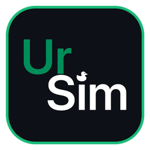
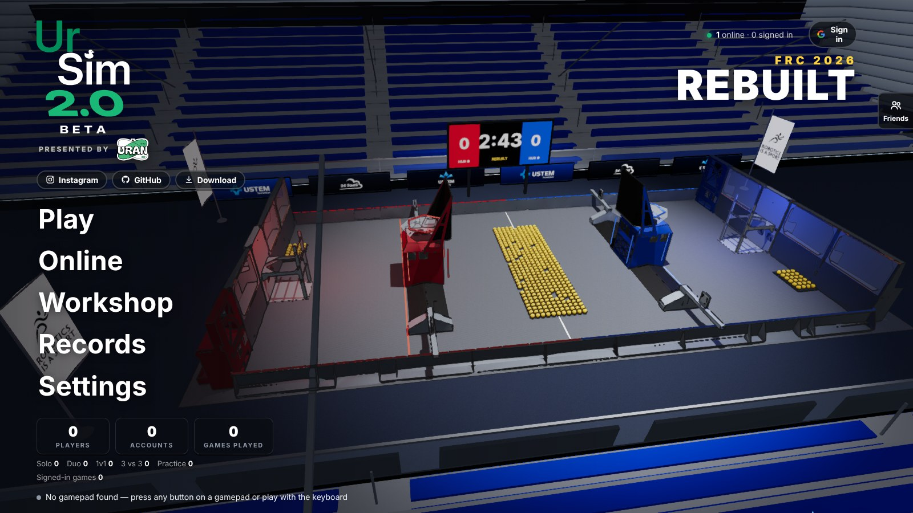
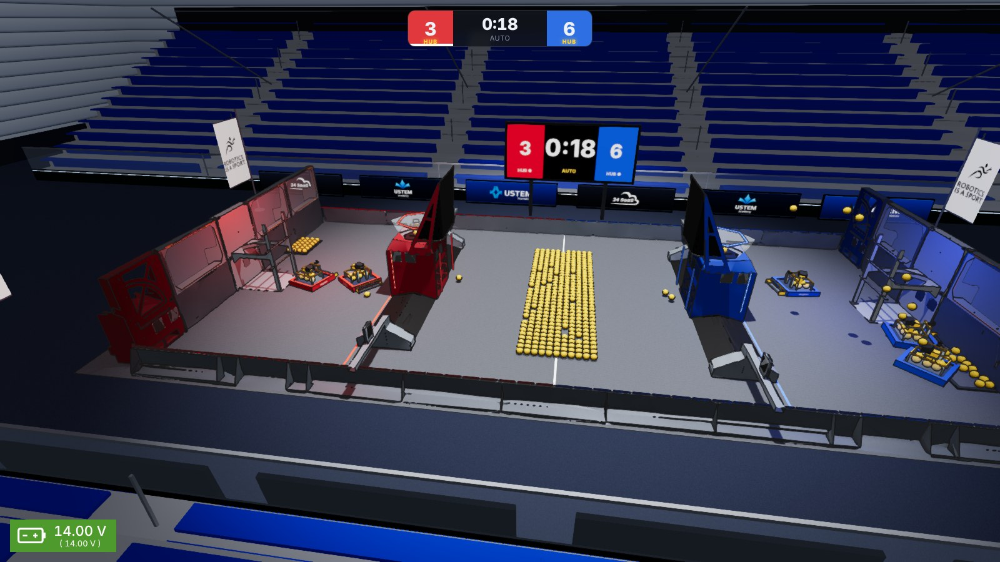

<p align="center"></p>

<h1 align="center">UrSim FRC</h1>

<p align="center">A <i>FIRST</i> Robotics Competition simulator for the 2026 season, <b>REBUILT</b>: the FRC edition of <a href="https://ursim.duckdns.org">UrSim</a></p>

<p align="center"><a href="../../releases/latest"><b>⬇ Download</b></a> · <a href="https://ursim.duckdns.org">UrSim website</a> · <a href="README.ru.md">Русский</a></p>



Drive an FRC robot around the REBUILT field: pick up FUEL, shoot it into your HUB while it is lit, cross the BUMPS or slip under the TRENCH, and climb the TOWER in END GAME. Full **2:43 matches** with live scoring, the HUB shifts, ranking points and an automatic referee, or practice without a clock. **3 vs 3** with AI partners and opponents (easy, medium or hard), **split screen** for two players, **online rooms** 1 vs 1 or 3 vs 3, a **Workshop** to build robots of your own, high score tables, accounts and a replay studio. The interface is in English, Russian and Kazakh.



## The game

**Field.** Built from the official *Team Practice Field* CAD and the 2026 Game Manual (section 5): 16.54 × 8.07 m, carpet with the ROBOT STARTING LINES and the CENTER LINE, two HUBS (opening 1.06 m at 1.83 m), four BUMPS (16.5 cm, driven over), four TRENCHES (22.25 in clearance: only low robots fit under), two TOWERS with rungs at 27 / 45 / 63 in, DEPOTS and OUTPOSTS. The plywood practice parts are painted in competition colours; the polycarbonate is clear; the HUB lights show which HUB is active.

**FUEL.** 504 balls with physics: 360 in the NEUTRAL ZONE, 24 in each DEPOT and each OUTPOST CHUTE, 8 pre-loaded in each robot.

**Match (manual tables 6-2, 6-3).** 3-2-1 → AUTO 0:20 → a 3 s pause → TELEOP 2:20: TRANSITION SHIFT 10 s, SHIFTS 1–4 of 25 s each, END GAME 30 s. Both HUBS are active in AUTO, TRANSITION and END GAME; in SHIFTS 1–4 they take turns, and the alliance that won AUTO starts with its HUB off. FUEL scored in an inactive HUB counts for nothing. The field's synthesized timer sounds mark each moment, and a scoreboard screen behind the field shows the clock, the scores and the HUB states.

**Scoring (6.5).** FUEL 1 point; TOWER LEVEL 1 in AUTO 15 points (two robots at most); TOWER at the end 10 / 20 / 30 for LEVELS 1–3. Ranking points: WIN 3, TIE 1, ENERGIZED at 100 FUEL, SUPERCHARGED at 360 FUEL, TRAVERSAL at 50 TOWER points. The results screen is laid out like an FRC audience display: AUTO, FUEL, TOWER and FOUL rows, the RP earned and each team's place in the ranking of the matches played since the page opened (manual table 10-1: RP, then points without fouls, AUTO points, TOWER points).

**Referee.** In matches the referee calls these rules by itself (each can be turned off in Settings → Rules):

| Rule | Not allowed | Penalty |
|---|---|---|
| G403 | Crossing the CENTER LINE completely in AUTO | MAJOR FOUL, plus one per contact with an opponent there |
| G405 | Launching FUEL out of the field | MINOR FOUL, MAJOR if repeated |
| G407 | Launching FUEL into the HUB from outside your ALLIANCE ZONE | MAJOR FOUL |
| G418 | Pinning an opponent for more than 3 s | MINOR FOUL, then a MAJOR every 3 s |
| G420 | Touching an opponent at its TOWER in END GAME | MAJOR FOUL, and it scores LEVEL 3 |

A MINOR FOUL gives the opponent 5 points, a MAJOR 15; a red card zeroes the alliance's match.

**Start position (G303).** Before a game each driver can place their robot: bumpers on the ROBOT STARTING LINE, inside the ALLIANCE ZONE, off the BUMPS, field elements and partner robots. The screen shows the field from above and tints the robot green where it may start.

## Robots

| Robot | Drive | Shooter | Hopper | Climb | Notes |
|---|---|---|---|---|---|
| **Skyline** | swerve, 5.3 m/s | turret ±200°, 9 FUEL/s | 45 | LEVEL 3 | low: fits under the TRENCH |
| **Twin Flywheel** | swerve | two fixed shooters, 14 FUEL/s | 55 | LEVEL 2 | tall: takes the BUMPS |
| **Double Deck** | swerve | turret ±135° | 35 | LEVEL 1 | intakes at both ends, fits under the TRENCH |
| **Bulldozer** | tank | fixed shooter | 30 | LEVEL 2 | heavy, pushes hard |
| **Kit Bot** | mecanum | fixed shooter | 20 | LEVEL 1 | light and quick |

Every robot has bumpers in its alliance's colour, an intake over the bumper, a hopper with clear walls that fills with the FUEL it holds, turrets with flywheels and a climber that reaches up to the TOWER rung. Shots are aimed by a ballistic solution for the HUB opening that allows for the robot's own motion; the battery starts at 14 V and sags under load.

**Workshop.** Build a robot of your own from blocks (size within the FRC frame perimeter and height limits, drivetrain, wheels, motor speed, weight, intakes front and back, hopper size, climber level and speed, 1–4 turrets) or upload its 3D model (GLB, glTF, OBJ, STL). Your robots play in every mode, sync with your account, travel as a `.ursimbot` file or a `URSIM-ROBOT:` code, and can go into the shared gallery. They never enter the high score tables.

## Modes

- **Match 2:43** and **Practice** (no clock, both HUBS always on).
- **AI**: none, an opponent (1 vs 1), or 3 vs 3 with partners, at easy, medium or hard. The bots collect FUEL, wait for their HUB to light, shoot from their ALLIANCE ZONE, get unstuck, and climb in END GAME.
- **Split screen**: two gamepads, two robots, each player with their own half of the screen.
- **Online**: rooms of 1 vs 1 or 3 vs 3, open or with a password, quick play, the AI on any free station.
- **Cameras**: driver station, audience (from the stands) and following the robot.
- **Replays**: after a match, watch it again with a timeline, highlights (start, volleys, climbs, finish) and several cameras; signed-in players keep an archive.

## Controls (defaults)

| Keyboard | Gamepad | Action |
|---|---|---|
| W A S D | left stick | drive |
| Q / E | right stick | turn |
| F | LB | intake |
| K | D-pad down | eject |
| Space | RB | feed the shooter (shoot) |
| Z / V | LT / RT | flywheel on / off |
| T | Y (△) | climb the TOWER (hold) |
| Tab | Back | field-centric on / off |
| Enter | Start | reset the IMU heading |
| C | R3 | camera |
| Esc | Guide | pause |

Every button can be changed in Settings → Controls.

## Running from source

```bash
npm install
npm run dev          # the game at http://localhost:5173
npm run server       # optional: high scores, accounts and online rooms
```

The production build is one process that serves the game and the server:

```bash
npm run build && npm run build:server && PORT=8787 npm start
```

## How it works

- `src/sim/`: the whole game without graphics: Rapier physics at 120 Hz, robots, mechanisms, HUBS, the match clock, scoring and the referee. The renderer only draws the world state, blended between physics steps, so the game moves evenly at any frame rate.
- `src/frc/`: the REBUILT field dimensions and rules from the manual.
- `src/view/`: the field, the arena (hall, stands, lighting truss, LED boards and the scoreboard screen), FUEL and robots, drawn with three.js and a post-processing chain (ambient occlusion and black outlines).
- `src/ai/`: the bots. `src/net/` and `server/`: online play over WebRTC, high scores, accounts, the gallery and replays. `desktop/`: the Electron app.
- `tools/convert-field.mjs` turns the field CAD (`Field/*.step`, not in the repository) into `public/assets/field.glb` and `field-layout.json`; `tools/build-colliders.mjs` bakes the field colliders. Both: `npm run convert:field`.

## Desktop app and hosting

`npm run desktop` runs the Electron app. Tagging a version (`git tag v1.0.0 && git push origin v1.0.0`) makes GitHub Actions build the Windows, macOS and Linux zips into a draft release. `render.yaml` deploys the website to Render; `deploy/` has a systemd service and a Caddy config for a VPS (see [deploy/README.md](deploy/README.md)). The high scores, accounts and statistics use `data/` by default, or Upstash Redis when `UPSTASH_REDIS_REST_URL` and `UPSTASH_REDIS_REST_TOKEN` are set; Google sign-in needs `GOOGLE_CLIENT_ID` and `GOOGLE_CLIENT_SECRET`.

## Checks

```bash
npm test
npm run build
```

## License

The code is released under the [MIT License](LICENSE). The field model is converted from *FIRST*'s official REBUILT Team Practice Field CAD.

Unofficial fan-made simulator, not affiliated with *FIRST*®. *FIRST*®, *FIRST*® Robotics Competition and REBUILT™ are trademarks of *FIRST*. The *FIRST* logos are not used.
