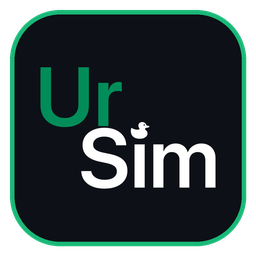
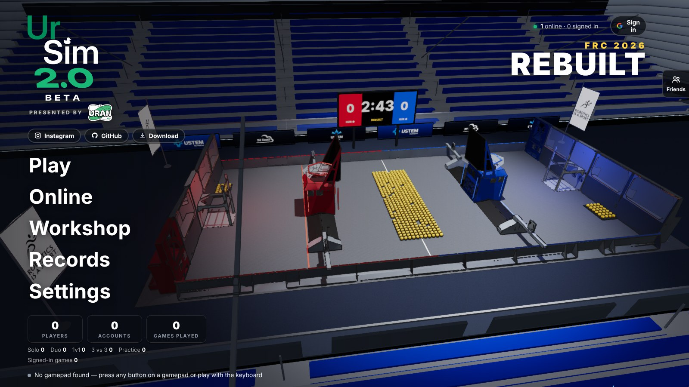
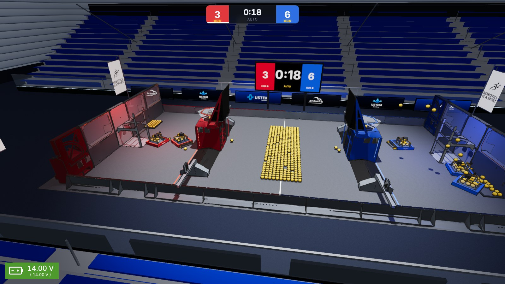

<p align="center"></p>

<h1 align="center">UrSim FRC</h1>

<p align="center">Симулятор <i>FIRST</i> Robotics Competition сезона 2026, <b>REBUILT</b>: FRC-версия <a href="https://ursim.duckdns.org">UrSim</a></p>

<p align="center"><a href="../../releases/latest"><b>⬇ Скачать</b></a> · <a href="https://ursim.duckdns.org">Сайт UrSim</a> · <a href="README.md">English</a></p>



Управляй FRC-роботом на поле REBUILT: собирай FUEL, забрасывай его в свой HUB, пока он горит, переезжай BUMP или проезжай под TRENCH и залезай на TOWER в END GAME. Полные **матчи 2:43** со счётом в реальном времени, сменой HUB, ranking points и автоматическим судьёй, или тренировка без таймера. **3 на 3** с ИИ-партнёрами и соперниками (лёгкий, средний, сложный), **разделённый экран** на двоих, **онлайн-комнаты** 1 на 1 и 3 на 3, **Мастерская** для своих роботов, таблицы рекордов, аккаунты и повторы матчей. Интерфейс на русском, английском и казахском.



## Игра

**Поле.** Собрано из официального CAD *Team Practice Field* и Game Manual 2026 (раздел 5): 16,54 × 8,07 м, ковёр с линиями ROBOT STARTING LINE и CENTER LINE, два HUB (вход 1,06 м на высоте 1,83 м), четыре BUMP (16,5 см, через них переезжают), четыре TRENCH (проезд 22,25 дюйма: проходят только низкие роботы), два TOWER с перекладинами на 27 / 45 / 63 дюймах, DEPOT и OUTPOST. Фанерные детали тренировочного поля окрашены в цвета соревновательного, поликарбонат прозрачный, огни HUB показывают, какой HUB активен.

**FUEL.** 504 мяча с физикой: 360 в NEUTRAL ZONE, по 24 в каждом DEPOT и каждом CHUTE у OUTPOST, по 8 в каждом роботе.

**Матч (таблицы 6-2, 6-3).** 3-2-1 → AUTO 0:20 → пауза 3 с → TELEOP 2:20: TRANSITION SHIFT 10 с, SHIFT 1–4 по 25 с, END GAME 30 с. В AUTO, TRANSITION и END GAME активны оба HUB; в SHIFT 1–4 они горят по очереди, и альянс, выигравший AUTO, начинает с выключенным. FUEL в неактивный HUB очков не даёт. Звуки таймера поля отмечают каждый момент, а экран за полем показывает время, счёт и состояние HUB.

**Очки (6.5).** FUEL 1 очко; TOWER LEVEL 1 в AUTO 15 очков (не больше двух роботов); TOWER в конце 10 / 20 / 30 за LEVEL 1–3. Ranking points: WIN 3, TIE 1, ENERGIZED за 100 FUEL, SUPERCHARGED за 360 FUEL, TRAVERSAL за 50 очков TOWER. Экран результатов как у FRC: строки AUTO, FUEL, TOWER и FOUL, полученные RP и место каждой команды в рейтинге сыгранных матчей (таблица 10-1: RP, затем очки без фолов, очки AUTO, очки TOWER).

**Судья.** В матче судья сам следит за правилами (каждое можно выключить в Настройки → Правила):

| Правило | Нельзя | Штраф |
|---|---|---|
| G403 | Целиком заезжать за CENTER LINE в AUTO | MAJOR FOUL и ещё один за каждый контакт с соперником там |
| G405 | Выбрасывать FUEL за поле | MINOR FOUL, при повторе MAJOR |
| G407 | Бросать в HUB не из своей ALLIANCE ZONE | MAJOR FOUL |
| G418 | Прижимать соперника дольше 3 с | MINOR FOUL, потом MAJOR каждые 3 с |
| G420 | Трогать соперника у его TOWER в END GAME | MAJOR FOUL, а он получает LEVEL 3 |

MINOR FOUL даёт сопернику 5 очков, MAJOR — 15; красная карточка обнуляет матч альянса.

**Стартовая позиция (G303).** Перед игрой каждый водитель может поставить робота: бамперы на ROBOT STARTING LINE, внутри ALLIANCE ZONE, не на BUMP, элементах поля и роботах партнёров. Экран показывает поле сверху и подсвечивает робота зелёным там, где можно стартовать.

## Роботы

| Робот | Шасси | Шутер | Бункер | Подъём | Особенность |
|---|---|---|---|---|---|
| **Skyline** | swerve, 5,3 м/с | турель ±200°, 9 FUEL/с | 45 | LEVEL 3 | низкий: проходит под TRENCH |
| **Twin Flywheel** | swerve | два неподвижных шутера, 14 FUEL/с | 55 | LEVEL 2 | высокий: ездит через BUMP |
| **Double Deck** | swerve | турель ±135° | 35 | LEVEL 1 | интейки с двух сторон, проходит под TRENCH |
| **Bulldozer** | танковое | неподвижный шутер | 30 | LEVEL 2 | тяжёлый, сильно толкает |
| **Kit Bot** | mecanum | неподвижный шутер | 20 | LEVEL 1 | лёгкий и быстрый |

У каждого робота бамперы цвета альянса, интейк над бампером, бункер с прозрачными стенками, который заполняется собранным FUEL, турели с маховиками и подъёмник, крюк которого тянется к перекладине TOWER. Выстрел наводится баллистикой на вход HUB с учётом движения робота; батарея начинается с 14 В и проседает под нагрузкой.

**Мастерская.** Собери своего робота из блоков (размер в пределах периметра рамы и высоты FRC, шасси, колёса, обороты мотора, вес, интейки спереди и сзади, размер бункера, уровень и скорость подъёма, 1–4 турели) или загрузи его 3D-модель (GLB, glTF, OBJ, STL). Свои роботы играют во всех режимах, синхронизируются с аккаунтом, передаются файлом `.ursimbot` или кодом `URSIM-ROBOT:` и публикуются в общей галерее. В таблицы рекордов они не попадают.

## Режимы

- **Матч 2:43** и **Тренировка** (без таймера, оба HUB всегда включены).
- **ИИ**: без него, соперник (1 на 1) или 3 на 3 с партнёрами, лёгкий, средний или сложный. Боты собирают FUEL, ждут, пока загорится их HUB, стреляют из своей ALLIANCE ZONE, выбираются, если застряли, и лезут на TOWER в END GAME.
- **Разделённый экран**: два геймпада, два робота, у каждого игрока своя половина экрана.
- **Онлайн**: комнаты 1 на 1 и 3 на 3, открытые или с паролем, быстрая игра, ИИ на любой свободной станции.
- **Камеры**: со станции водителя, с трибуны и за роботом.
- **Повторы**: после матча его можно пересмотреть с таймлайном, лучшими моментами (старт, залпы, подъёмы, финиш) и разными камерами; у вошедших в аккаунт матчи сохраняются в архив.

## Управление (по умолчанию)

| Клавиатура | Геймпад | Действие |
|---|---|---|
| W A S D | левый стик | езда |
| Q / E | правый стик | поворот |
| F | LB | интейк |
| K | крестовина вниз | выбросить мяч |
| Space | RB | подача в шутер (выстрел) |
| Z / V | LT / RT | маховик вкл / выкл |
| T | Y (△) | подъём на TOWER (держать) |
| Tab | Back | езда относительно поля вкл / выкл |
| Enter | Start | сброс курса IMU |
| C | R3 | камера |
| Esc | Guide | пауза |

Любую кнопку можно поменять в Настройки → Управление.

## Запуск из исходников

```bash
npm install
npm run dev          # игра на http://localhost:5173
npm run server       # по желанию: рекорды, аккаунты и онлайн-комнаты
```

Боевая сборка — один процесс, который отдаёт игру и работает сервером:

```bash
npm run build && npm run build:server && PORT=8787 npm start
```

## Как устроено

- `src/sim/`: вся игра без графики: физика Rapier 120 Гц, роботы, механизмы, HUB, таймер матча, очки и судья. Рендер только рисует состояние мира, сглаженное между шагами физики, поэтому игра идёт ровно при любом FPS.
- `src/frc/`: размеры поля REBUILT и правила из мануала.
- `src/view/`: поле, арена (зал, трибуны, ферма со светом, LED-табло и экран со счётом), FUEL и роботы на three.js с постобработкой (ambient occlusion и чёрные контуры).
- `src/ai/`: боты. `src/net/` и `server/`: онлайн по WebRTC, рекорды, аккаунты, галерея и повторы. `desktop/`: приложение на Electron.
- `tools/convert-field.mjs` переводит CAD поля (`Field/*.step`, в репозиторий не входит) в `public/assets/field.glb` и `field-layout.json`; `tools/build-colliders.mjs` собирает коллайдеры поля. Оба шага: `npm run convert:field`.

## Приложение и хостинг

`npm run desktop` запускает приложение на Electron. Тег версии (`git tag v1.0.0 && git push origin v1.0.0`) запускает в GitHub Actions сборку zip для Windows, macOS и Linux в черновик релиза. `render.yaml` разворачивает сайт на Render; в `deploy/` есть служба systemd и конфиг Caddy для VPS (см. [deploy/README.md](deploy/README.md)). Рекорды, аккаунты и статистика по умолчанию лежат в `data/`, а с переменными `UPSTASH_REDIS_REST_URL` и `UPSTASH_REDIS_REST_TOKEN` — в Upstash Redis; вход через Google требует `GOOGLE_CLIENT_ID` и `GOOGLE_CLIENT_SECRET`.

## Проверки

```bash
npm test
npm run build
```

## Лицензия

Код распространяется по [лицензии MIT](LICENSE). Модель поля переведена из официального CAD REBUILT Team Practice Field от *FIRST*.

Неофициальный фанатский симулятор, не связан с *FIRST*®. *FIRST*®, *FIRST*® Robotics Competition и REBUILT™ — товарные знаки *FIRST*. Логотипы *FIRST* не используются.
